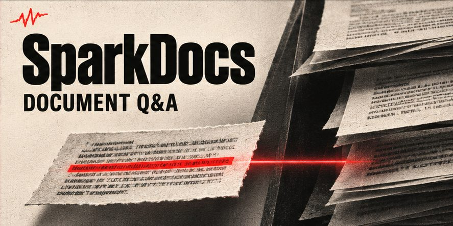

# SparkDocs



**Status: alpha.** SparkDocs is a local-first document ingestion and grounded chat
tool for PDF, DOCX, and PPTX files. It is intended for people who want to inspect ordinary
documents with an explicit bring-your-own-key model rather than upload them to a managed document
store.

SparkDocs validates and extracts documents in memory, builds structure-aware overlapping chunks,
and retrieves evidence locally using dense embeddings plus BM25 keyword search. Reciprocal rank
fusion (RRF) combines those results, a local cross-encoder reranks them, and only a bounded evidence
set is sent in one request to the user-selected Gemini, OpenAI, or Anthropic model. Returned citation
labels are restricted to retrieved locations;
SparkDocs does not independently prove that every generated claim is entailed by its citation.

Ask follow-up questions in a conversation about one document. When asking a cloud model, SparkDocs
can use up to two questions from earlier successful turns with that provider, capped at 600
characters in total, to retrieve fresh evidence. Open the source expanders beneath an answer to read
the excerpts for that turn.

## What it does

- Accepts one PDF, DOCX, or PPTX document up to 10 MiB.
- Checks filename, extension, media type, file signature, and OOXML archive structure.
- Limits archive members, expanded size, compression ratio, pages/slides, sections, and extracted
  characters.
- Preserves PDF page, DOCX paragraph/table-row, and PPTX slide locators.
- Uses local FastEmbed ONNX models for dense retrieval and cross-encoder reranking.
- Applies a strict evidence budget and rejects citations outside the retrieved-location allowlist.
- Keeps uploads, extracted content, and chat history in Streamlit session memory.
- Sends character-bounded selected evidence, the current question, and bounded recent user questions
  to the explicitly selected Gemini, OpenAI, or Anthropic model using a session-only user key.
- Treats document content as untrusted data and does not give it tools or external authority.

## What it does not do

- It does not authenticate users. The former public shared passkey has been removed.
- It does not persist documents, indexes, questions, answers, or API keys.
- It does not support scanned/image-only documents, OCR, encrypted files, macros, or arbitrary
  archive formats.
- It does not guarantee answer correctness, completeness, citation accuracy, or protection suitable
  for confidential, regulated, or adversarial documents.
- It does not expose a network MCP service, arbitrary filesystem access, model-authored code, OCR,
  or document editing.

## Local installation

Prerequisites:

- Python 3.11, 3.12, or 3.13
- [uv](https://docs.astral.sh/uv/)
- A Gemini, OpenAI, or Anthropic API key for Q&A; ingestion and tests do not need a key
- Network access on first interactive use to download the local embedding and reranking model
  weights; subsequent runs use the local model cache

```bash
git clone https://github.com/Sparkience-AI/SparkDocs.git
cd SparkDocs
uv sync --locked
uv run --locked streamlit run streamlit_app.py
```

Open <http://127.0.0.1:8501> and upload one supported document or select the built-in sample.
To generate an answer, select Gemini, OpenAI, or Anthropic, confirm the model ID, enter the matching
API key, and explicitly confirm cloud transmission. The cost-conscious defaults are
`gemini-3.8-flash`, `gpt-6-luna`, and `claude-haiku-5-5`; model availability depends on the user's
provider account and the field is editable. The committed local configuration binds Streamlit to
loopback and disables Streamlit usage reporting. Keys are passed directly to session-owned clients;
they are not copied into the process environment or written to disk. OpenAI requests explicitly set
`store=false`. FastEmbed downloads model weights from Hugging Face on first use and caches them
locally. Embedding and reranking run on your machine using the installed models.

### Try the sample handbook

1. Under **Document source**, select **Try the sample handbook**. SparkDocs indexes a fictional
   equipment claims handbook using the same pipeline as an uploaded PDF. Allow time for the first
   model downloads during upload or search.
2. Select **Find local evidence**, fill the chat input with the sample question about the outdoor
   battery claim deadline, and submit it. Page 3 gives the seven-day outdoor deadline. Page 2
   describes a separate 30-day indoor deadline. Local evidence lookup works without an API key.
3. To try cloud chat, choose a provider, enter your key, confirm consent, and select
   **Ask SparkDocs**. Submit the outdoor question and expand the citation beneath the answer to
   inspect the seven-day deadline.
4. Follow up with *What about indoor ones?* Page 2 gives the indoor deadline of 30 days. Each chat
   answer keeps its own source excerpts. You can also ask *How many replacement kits can one member
   borrow at once?* The handbook describes availability but gives no borrowing limit.
5. Replace the document to start a new conversation, or use **Clear document, provider settings,
   and keys** to end the session.

Each chat tab keeps its own conversation. **Ask SparkDocs** automatically chooses between general and document answers when a document is
loaded. **Document only** always uses retrieved sources. **General chat** works without a document,
and **Find local evidence** makes no provider request. Supported providers stream replies, with
document citations checked before the answer is retained in the conversation.

## Hosted demo

The historical demo URL is <https://sparkdocs.streamlit.app/>. The local sample above is the
documented walkthrough for this repository. Availability and revision of the historical deployment
are unverified. In a hosted deployment, the server receives the document and API key in memory.
Use disposable low-quota keys and non-sensitive documents for hosted demos.

## Security and privacy

Read the [privacy contract](docs/privacy.md), [security model](docs/security.md), and
[architecture and limits](docs/architecture.md) before processing documents. Important boundaries:

- The selected cloud provider receives the current question, bounded recent user questions from that
  provider's successful turns, and freshly selected excerpts when chat sends a request. Earlier
  answers and local-only questions are excluded from the cloud context.
- Filename and archive validation reduce common ingestion risks but do not replace malware scanning
  or parser isolation.
- Parser execution is currently in-process and has no operating-system sandbox or hard wall-clock
  timeout. This is a known alpha limitation.
- No prompt, document text, answer, key, or filename should be logged or included in test artifacts.

## Development

```bash
uv run --locked ruff format --check .
uv run --locked ruff check .
uv run --locked mypy src
uv run --locked pytest
uv build --no-sources
```

The tests use generated synthetic documents and a fake model provider; normal CI does not require a
credential, network request, or real user document.

The [retrieval case study](docs/retrieval-case-study.md) covers the original holdout and live
OpenAI results. The separate challenge set checks evidence selection on a longer PDF section,
a DOCX table, and a slide deck. It uses the cached local models and makes no cloud provider calls.

```bash
uv run --locked python -m benchmarks.sparkdocs.challenge --local-models
```

## Local MCP and agent skill

Install the optional MCP dependency and start the stdio server with an intentionally narrow root:

```bash
uv sync --locked --extra mcp
uv run --locked --extra mcp sparkdocs-mcp --allowed-root ./documents
```

On Windows, add `--warm-models` to load both retrieval models before the MCP server accepts
requests. Allow time for first-use model downloads. To verify the Codex CLI integration from
PowerShell, run `./scripts/test_codex_mcp.ps1` with a signed-in Codex CLI. The script uses a
synthetic PDF, checks all four MCP replies, and confirms the document is cleared.

The server holds one document in memory and exposes four tools: `ingest_document`,
`search_document`, `document_status`, and `clear_document`. It never accepts an API key, generates
an answer, opens a network listener, or reads outside the configured root. First indexing can still
download the documented local FastEmbed weights.

The repo-local skill at `.agents/skills/sparkdocs-grounded-qa` teaches compatible agents to ingest,
retrieve, cite exact locators, resist document prompt injection, and abstain when evidence is
insufficient. The MCP is the controlled evidence surface; the skill is the workflow layer.

See the [threat model](docs/threat-model.md), [performance envelope](docs/performance.md), and
[release checklist](RELEASE_CHECKLIST.md) for release gates.

## Architecture

```text
Streamlit UI
    │
    ├── bounded upload validation and extraction
    │       └── normalized document sections with source locators
    │
    ├── structure-aware overlapping chunks
    │       └── local dense + BM25 retrieval → RRF → cross-encoder reranking
    │
    └── bounded, escaped question context and evidence
            └── one grounded provider request + per-answer citation validation
```

The shared core lives under `src/sparkdocs`; the current Streamlit UI remains the source-checkout
entry point. The built wheel is the reusable core package rather than a complete desktop or server
distribution. Future UI, MCP, or agent surfaces must call the same core rather than duplicate
parsing or security logic.

## License and support

SparkDocs is available under the [MIT License](LICENSE). Use GitHub issues for reproducible bugs and
feature proposals. Do not post real documents, credentials, or confidential content in an issue.
